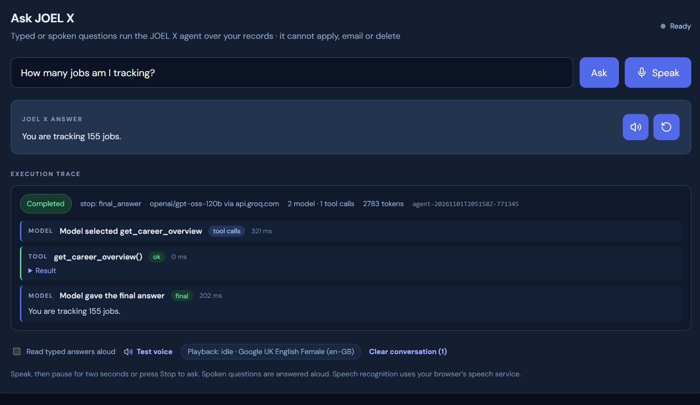

# JARVIS & JOEL X — a supervised AI workflow case study

**Enterprise technology sales experience applied to supervised AI workflows.**

I am developing JARVIS, a local assistant that brings career research and agent tasks into one interface. The aim is to make work traceable and reviewable while keeping consequential decisions with the user.

## The problem

Research, application history, document drafts and agent outputs were spread across separate tools. I wanted a workflow that could answer questions from recorded data, delegate a bounded task and show what needed human review.

## My contribution

I defined the workflows, evidence requirements and approval rules; prioritised the work; and directed implementation with AI coding tools. I reviewed document claims against my actual experience, operated the system and used acceptance checks to distinguish working behaviour from unsupported claims.

## What has been demonstrated

- A spoken career-status question returned a recorded summary in the HUD and was read aloud.
- The approval summary distinguished agent results from career decisions, with explicit handling of unavailable career counts.
- One planning request reached an existing agent, produced one linked execution record and left a three-item result awaiting review.
- A 72-check staged regression suite passed, alongside recorded backup, separate-copy restore and startup/recovery checks.

## How the parts fit

**JARVIS HUD → supervised Workforce task service → recorded result → human review.** JOEL X remains the separate career engine and record store.

The current Windows pilot uses Python services, SQLite career records, JSON/JSONL task records, a React/TypeScript HUD and local Ollama planning. Restricted Claude execution is another implemented lane; the demonstrated checklist run used local Ollama.

## What I learned and what is next

The checklist took almost five minutes and triggered a misleading outbound-action warning. Those findings drive the next corrections. Granular monitoring, durable task recovery, memory and wider coordination still need acceptance evidence.

This is a working local engineering pilot. Production reliability, time savings and hiring outcomes have not been measured. I reuse existing components and direct AI-assisted implementation; I do not claim to have manually written every component.

## Selected demonstration

The image below is a **historical read-only JOEL X development interaction from 1 November 2026**, not a capture of the newer Windows voice/delegation tests.

This image shows the earlier development interaction; it is separate from the recent Windows acceptance checks.

## Why this matters to my next role

It connects my enterprise sales experience with practical workflow discovery, requirements definition, technical evaluation and evidence-based product decisions. It demonstrates growing technical AI fluency alongside my established commercial background.

[GitHub profile](https://github.com/JoelGPascal) · [LinkedIn](https://www.linkedin.com/in/joelgabrielpascal/)

Reviewed 18 November 2026. Source code and private operational records remain private.
