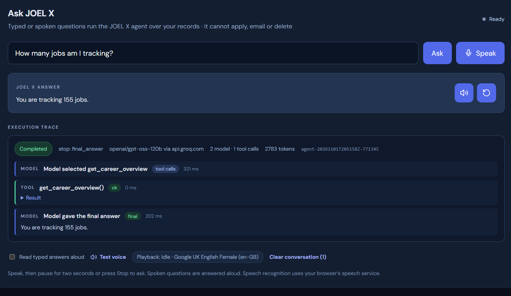

# Joel Gabriel Pascal
### Enterprise Account Executive | Founding GTM | SaaS, Data & AI Solutions

I help buyers evaluate complex technology and turn new markets into sales opportunities. My background spans enterprise SaaS, APIs and data, French-market development and founder-led commercial operations.

At Webz.io (May 2023–February 2025), I closed **$2.5M+ in API/data sales**, generated **$3.5M+ in self-sourced pipeline** and averaged **118% of quota**. At Guesty (May 2017–July 2020), I developed the French market and, across my wider responsibilities, closed **$1.5M+ in SaaS sales at 112% of quota**.

I also run a US-registered business and have built AI-assisted workflows. That practical experience helps me work across commercial and technical teams; my core strength remains winning complex sales and developing markets.

**Tel Aviv, Israel · British and Israeli citizen · Native English · Fluent French**

## Commercial evidence

**Cybersecurity data evaluation:** A customer needed better data for leaked-credential detection. I requalified the SDR handoff using MEDDIC, aligned 4–5 stakeholders and coordinated a three-week competitive POC with pre-sales. We agreed success criteria, timelines and mutual responsibilities; I progressed pricing and legal review through signature. This is an anonymized career account, without a claimed deal value or detection uplift.

**Guesty international market development:** Started selling into the US market, then after approximately eight months transitioned to French-speaking markets including France, Belgium, Luxembourg and Canada. Built pipeline through prospecting, discovery and demonstrations, and collaborated with marketing; trained two SDRs. Ahead of Guesty's Australian office expansion, developed a partnership with BnBProfessional after an initial pricing objection: researched the business and Australian hosts, re-engaged the prospect and established the relationship. Led Zoom demonstrations for hundreds of attendees, handled live Q&A and one-to-one follow-ups, helping bring in more than 100 SMB customers. Also engaged audiences at Australian conferences. The $1.5M+ sales and 112% quota figures cover wider Guesty responsibilities; the Australian partnership is separate from French-market development.

## Featured technical case study

### JOEL X — AI-assisted career research and application preparation
**Problem:** Job research, candidate evidence and application history were spread across sources.

**My contribution:** Defined requirements, eligibility and review rules; directed AI-assisted implementation; operated the dashboard and reviewed generated materials against my actual experience.

**Demonstrated result:** On November 1, 2026, a live dashboard question—“How many jobs am I tracking?”—returned **155 jobs**. The visible execution trace showed the model selecting `get_career_overview()`, a successful tool response and a completed final answer through Groq. The captured interaction is shown below.

*Captured November 1, 2026 in the development environment. The trace shows a completed read-only query over stored records. This demonstrates this interaction, rather than production reliability or measured time savings.*

**Stack:** Python, Next.js, SQLite, Groq-hosted LLMs. The source and database remain private. This is a development prototype with manually reviewed application drafts. The published capture demonstrates a typed query. The maintained career record separately documents user-observed spoken playback in development. That is not independent verification of a microphone-to-answer cycle or production voice reliability. Application-enforced approval is not established by the public capture.

## Additional public code

[CRM Association Verifier](https://github.com/JoelGPascal/crm-association-verifier) · [PDH Revenue Intake Demo](https://github.com/JoelGPascal/pdh-revenue-intake-demo)

These remain available as supporting prototypes; JOEL X is the sole featured technical case study.

## Background

- **Webz.io:** Full-cycle API/data sales to banking, cybersecurity and other enterprise customers; discovery, technical POCs, procurement and signature.
- **Guesty:** French-market development, SaaS sales, SDR training and partnerships.
- **Pascal Dominion Holdings:** Founder-led U.S. real-estate operations, CRM workflow design and practical AI experimentation.

## Further development

**JARVIS / Hermes:** Private infrastructure experiments with model routing and agent orchestration. A recovered session records successful Groq inference and a proposed tool call; completed autonomous tool execution is not established.

I am developing my technical capabilities toward AI solutions and GTM systems work, grounded in enterprise selling and operating experience.

## Evidence and status

Commercial figures are career-history results; they are not independently audited. Technical test results are dated offline checkpoints; they are separate from the live JOEL X interaction. The projects do not establish measured time savings, production reliability or autonomous application submission. Private customer records and credentials are excluded.

## Connect

[Portfolio](https://false-ash-26c.notion.site/Joel-Pascal-portfolio-Enterprise-Sales-GTM-and-Practical-AI-40b5622002f981709ab3e773187085f3) · [LinkedIn](https://www.linkedin.com/in/joelgabrielpascal/) · [Public projects](https://github.com/JoelGPascal?tab=repositories)
