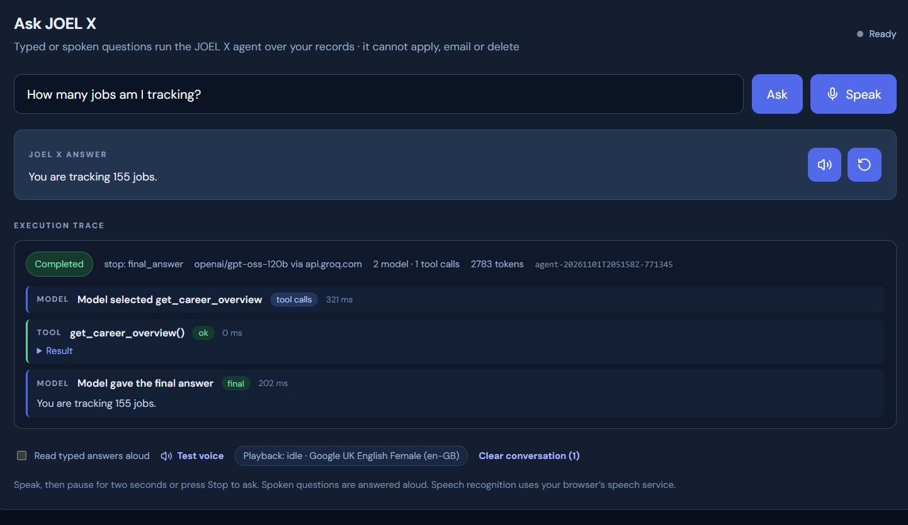

# Joel Gabriel Pascal
### Enterprise Account Executive | Founding GTM | SaaS, Data & AI Solutions

I help buyers evaluate complex technology and turn new markets into revenue.
I'm a UK national now based in Tel Aviv · Native English · Fluent French

- **Webz.io (2023–2025):** $2.5M+ in API/data sales, $3.5M+ self-sourced pipeline, 118% average quota
- **Guesty (2017–2020):** $1.5M+ in SaaS sales at 112% of quota; developed the French market and an Australian partnership channel that brought in 100+ customers
- **Pascal Dominion Holdings (2025–present):** Founder of a US real estate business, where I build the AI systems I use to run it

---

## What I've built

Two separate AI systems for two real jobs, plus one dashboard designed to control both.

```
             ┌──────────────────────────┐
             │     JARVIS dashboard     │  one place to see and run everything
             └────────────┬─────────────┘
          ┌───────────────┴───────────────┐
 ┌────────▼──────────┐          ┌─────────▼─────────┐
 │  PDH Real Estate  │          │  JOEL X Career    │
 │  AI system        │          │  Agent            │
 └───────────────────┘          └───────────────────┘
```

| Project | What it does | Code |
|---|---|---|
| **JARVIS** | Voice-enabled command dashboard: one screen for both systems. JOEL X is connected; PDH integration is next | Private prototype |
| **PDH Real Estate AI** | Turns messy property listings into reviewed leads and checks CRM records are linked correctly before automation acts | [Intake demo](https://github.com/JoelGPascal/pdh-revenue-intake-demo) · [CRM verifier](https://github.com/JoelGPascal/crm-association-verifier) |
| **JOEL X Career Agent** | Finds jobs, scores fit and drafts applications. I built and tested it on my own job search first | Private prototype |

**Design rule across all three:** automate the predictable path, and send anything uncertain to a human. Nothing is sent, published or changed in a CRM without approval.

<!-- UPDATE AFTER CHATGPT'S JOEL X WORK: refresh the screenshot, job count and stack below -->
### JOEL X in action

Asked "How many jobs am I tracking?", the agent picked the right tool, read my records and answered: **155 jobs**.



*Python · Next.js · SQLite · Groq-hosted LLMs*

---

## Commercial highlights

**Cybersecurity data deal (Webz.io):** Requalified an SDR handoff using MEDDIC, aligned 4–5 stakeholders, ran a three-week competitive POC with pre-sales, and took pricing and legal review through to signature.

**Australia partnership (Guesty):** Turned a partner's pricing objection into a partnership with BnBProfessional, then ran Zoom demos for hundreds of hosts. The partnership brought in 100+ SMB customers.

---

<sub>Private code, customer data and credentials are kept out of public repos.</sub>

[Portfolio](https://false-ash-26c.notion.site/Joel-Pascal-portfolio-Enterprise-Sales-GTM-and-Practical-AI-40b5622002f981709ab3e773187085f3) · [LinkedIn](https://www.linkedin.com/in/joelgabrielpascal/)
