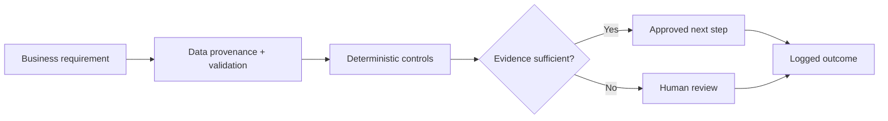

# Joel Gabriel Pascal
### Enterprise GTM & Strategic Sales · AI Solutions · Revenue Systems Engineering

I work at the intersection of **enterprise commercial execution and practical software engineering**: translating customer and operating problems into measurable workflows, API integrations, verification controls, and responsible AI-assisted systems.

My background includes enterprise SaaS, data and API sales, international market development, and founder-led operations. I build and document technical prototypes to demonstrate how those disciplines connect.

**Focus:** Enterprise AI GTM · Solutions / Forward-Deployed Engineering development · CRM & Revenue Automation · Python · APIs · Agentic AI

---

## Selected evidence

| Area | Documented result | Evidence boundary |
| --- | --- | --- |
| Enterprise API & data sales — Webz.io | $2.5M+ closed revenue; 118% average quota attainment; $3.5M+ self-generated pipeline | Career-history figures; not independently audited in this repository |
| Enterprise SaaS — Guesty | $1.5M+ closed revenue; 112% average quota attainment | Career-history figures; not independently audited in this repository |
| CRM relationship verification | 23 test cases visible in current source; execution not rerun in this review; read-only Cloudflare Worker | Sanitized public code and tests; not certified as a production deployment |
| Revenue intake controls | 8 documented passing local tests; Python synthetic-data prototype | No live CRM or outbound automation claimed |
| JOEL X career research | 48/48 offline tests on pinned private baseline | External calls and model responses mocked |
| JARVIS / Hermes | Recovered session reports successful authorized Groq model inference | Generated tool call was not completed; no end-to-end autonomy claimed |

## Public engineering work

### [CRM Association Verifier](https://github.com/JoelGPascal/crm-association-verifier)
**Cloudflare Workers · JavaScript · REST APIs · Data integrity · Defensive engineering**

A read-only verification layer for CRM Property–Contact–Opportunity associations. Designed to **fail closed** when identities, relationships, pagination, or upstream evidence cannot be trusted.

- Explicit identity and relationship matching; human-review path for ambiguity.
- Bounded API calls, pagination checks, and credential-safe decision logging.
- **Evidence:** 23 test cases visible in current source; execution not rerun in this review.
- [Architecture and source](https://github.com/JoelGPascal/crm-association-verifier) · [Commercial context](https://github.com/JoelGPascal/crm-association-verifier/blob/main/docs/COMMERCIAL_CONTEXT.md)

### [Revenue Intake — Safe Listing Demo](https://github.com/JoelGPascal/pdh-revenue-intake-demo)
**Python · Data normalization · Provenance · Human approval gates**

A synthetic-data prototype that converts third-party property listing inputs into **review-required records**, without treating unverified listings, ARV estimates, or contact permissions as established facts.

- Stable source identity, explicit unverified fields, and conservative default decisions.
- No scraping, live CRM writes, or outbound marketing in this public demo.
- **Evidence:** 8 documented passing local tests.
- [Source and methodology](https://github.com/JoelGPascal/pdh-revenue-intake-demo) · [Commercial context](https://github.com/JoelGPascal/pdh-revenue-intake-demo/blob/main/docs/COMMERCIAL_CONTEXT.md)

## Private development — public technical summaries

### JARVIS — Agentic AI infrastructure
**Hermes Agent · FreeLLMAPI · Groq · Model routing · Permission boundaries**

Private infrastructure work exploring controlled agent orchestration and model access. The October 28, 2026 Codespaces handoff reports Hermes Agent v0.21.5, FreeLLMAPI v0.16.10, and a **successful authorized inference request** using Groq's `openai/gpt-oss-120b`. The model generated a tool call, but **tool execution was not completed**. This is a live inference checkpoint, **not** proof of a production autonomous agent.

### JOEL X — Career intelligence prototype
**Python · Job-board ingestion · Deduplication · Eligibility rules · Ranking · Human review**

Private prototype for public job-board research across three career tracks: Enterprise Sales & GTM; AI Solutions & Agentic Engineering; and GTM Engineering & CRM Automation. **48/48 offline tests** passed on a pinned code baseline; network/model interactions were mocked. No automatic applications or live autonomous operation are claimed.

## How I approach engineering

I prioritize **verifiable behavior over impressive-sounding claims**: smallest useful prototypes, clear boundaries, conservative defaults, and human authorization for consequential actions.

## Professional background

- **Webz.io:** Enterprise API, data, and intelligence solutions; complex sales cycles and strategic accounts.
- **Guesty:** Enterprise SaaS sales and international go-to-market development.
- **Pascal Dominion Holdings:** Founder-led U.S. real-estate operations and revenue-workflow design.

**Career direction:** Enterprise AI GTM, AI Solutions Engineering, Forward-Deployed Engineering development, and GTM/Revenue Systems Engineering.

## Connect

- [LinkedIn](https://www.linkedin.com/in/joelgabrielpascal/)
- [GitHub projects](https://github.com/JoelGPascal)

*This profile distinguishes public source evidence, offline tests, recovered session reports, and personal career-history claims. Private customer information, credentials, and internal repositories are intentionally excluded.*
